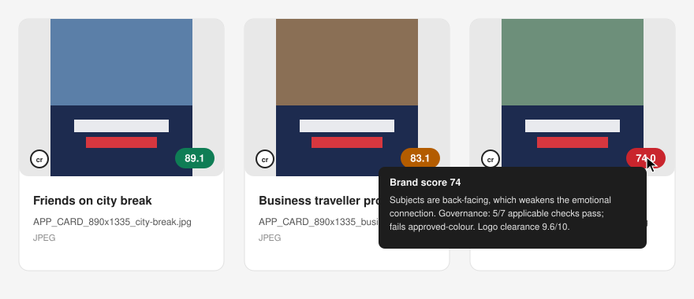
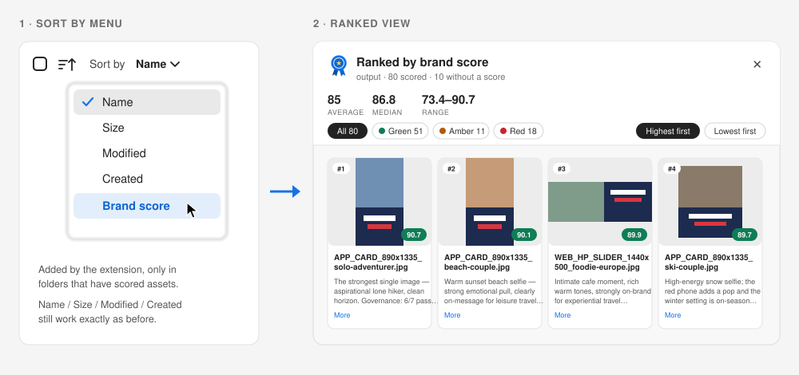
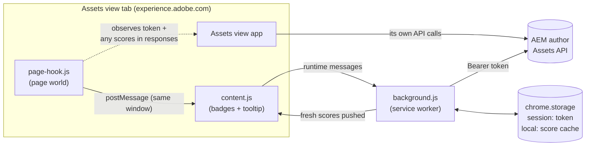

<p align="center">
  
</p>

<h1 align="center">AEM Grid Brand Score</h1>

<p align="center">
  A Chrome extension that shows each asset's <b>brand score</b> right on its card in the
  <b>Adobe Experience Manager Assets view</b> grid, so you can compare creative side by side
  instead of opening one asset at a time.
</p>

<p align="center">
  
</p>

---

## Why

Brand-governance scoring writes two metadata fields onto each asset:

| Field | Example | Meaning |
|---|---|---|
| `xdm:score` | `83.1` | Blended brand score, 0–100 |
| `xdm:brandScoreNotes` | "Polished solo airport moment… Logo clearance 8.8/10…" | Why the asset got that score |

Out of the box, the Assets view shows these only in an asset's **Details** panel. A score means far more next to the other assets' scores. You can spot the weakest variant in a batch, compare sizes of the same concept, or check that a re-render actually improved things.

AEM's supported extension points can't do this today. App Builder extensions for the Assets view can add actions, menus and Details panels, but they can't draw anything on grid cards, and cards can't be configured to show custom metadata. This extension fills that gap in your own browser.

## Features

- **Score badge on every card**, colour-coded by band. You choose one of two colour modes on the Options page:

  | Badge | Fixed thresholds (default) | Relative to the folder |
  |---|---|---|
  | 🟢 Green | score ≥ 85 | top 25% of the folder's scores |
  | 🟠 Amber | 80 ≤ score < 85 | middle 50% |
  | 🔴 Red | score < 80 | bottom 25% |

  - **Fixed** compares every asset to the same bar, so it suits customers with an agreed brand-score target.
  - **Relative** always picks out the strongest and weakest work in the set, so it suits batches that all score high (or low).
  - The thresholds and percentages are both editable.

- **Notes on hover.** Hover a badge to read `xdm:brandScoreNotes`. The tooltip opens below and to the left of the cursor, clear of the scrollbar and the window's edge, and flips above when there isn't room below.
- **Sort by › Brand score.** This adds a **Brand score** entry to the Assets view's own **Sort by** menu, which opens a ranked view of the whole folder. See [Ranked view](#ranked-view-sort-by--brand-score).
- **Works in any folder.** Assets without a score, such as InDesign files, JSON or logs, simply get no badge.
- **Stays out of the way.** The badge sits at the bottom right of the thumbnail, so it doesn't cover the Content Credentials (`cr`) icon at the bottom left. Clicking a badge doesn't open the asset.
- **Fast.**
  - It fetches a whole folder's scores in a couple of requests instead of one per asset.
  - It remembers scores, so revisiting a folder shows badges instantly and then refreshes quietly in the background.
- **Robust.**
  - It survives virtualized scrolling, folder navigation and expired login tokens.
  - It retries server errors and network drops with backoff.
  - It degrades gracefully if an API is unavailable.
- **No separate login.** It reuses the session you already have in the Assets view.

## Requirements

- **Google Chrome 111 or later**, or another Chromium browser that supports Manifest V3 `world: "MAIN"` content scripts.
- **AEM as a Cloud Service with the Assets view**, i.e. `experience.adobe.com/#/@<org>/assets/...`. The classic Touch UI (`/assets.html`) isn't supported.
- **The score fields on your assets.** They must be in the asset metadata (`jcr:content/metadata`) as `xdm:score`, and optionally `xdm:brandScoreNotes`.
- **Permission to read the assets**, which you already have if you can see them.

## Installation

The extension isn't on the Chrome Web Store. You load it unpacked:

1. **Get the code.**
   ```bash
   git clone https://github.com/pnamadobe/grid-brand-score.git
   ```
   You can also download the ZIP from GitHub and unzip it.
2. **Open `chrome://extensions`** and turn on **Developer mode** (top right).
3. **Click Load unpacked** and select the `grid-brand-score` folder.
4. **Pin it (optional).** Click the puzzle-piece icon in Chrome's toolbar, then the pin next to **AEM Grid Brand Score**. The blue ribbon now sits in your toolbar.
5. **Open or refresh an Assets view folder**, e.g.
   `https://experience.adobe.com/?repoId=author-pXXXXX-eYYYYY.adobeaemcloud.com#/@yourorg/assets/browse/content/dam/...`

### Updating

Pull the latest code, or replace the folder. Then click the **⟳ reload** button on the extension's card in `chrome://extensions` and refresh any open Assets tabs.

## Using it

There's nothing to do. Browse folders as usual and the badges appear on their own.

- **First load after starting Chrome, or after reloading the extension:** this takes a few seconds. The extension waits for the Assets view's first request to AEM, borrows its login token, then fetches the folder's scores.
- **Revisiting a folder:** badges appear immediately from the saved scores, then update in place if anything changed.
- **Changing folders:** badges load for the new folder automatically.

### Ranked view (Sort by › Brand score)

<p align="center">
  
</p>

Open the **Sort by** menu above the grid and choose **Brand score**. That opens a ranked view of every asset in the folder, including ones you haven't scrolled to yet. The entry only appears in folders that contain at least one asset with an `xdm:score`.

- **Summary:** how many assets are scored, plus the average, median and range.
- **Band filters:** **All**, **Green**, **Amber** or **Red**, each with a count. In relative mode the chips read **Top 25%**, **Middle 50%** and **Bottom 25%**. Ranks re-number within the filter.
- **Order:** **Highest first** or **Lowest first**. Your choice is remembered.
- **One tile per asset:** rank, thumbnail, score badge, file name and the full brand-score notes (**More** expands long notes).
- **Click a thumbnail or name** to open that asset's Details page.
- **Close** with **Esc**, the ✕, or a click outside the panel.

Why it's a view rather than a re-sort of the grid:
- The Assets view can only ask AEM to sort by name, size, modified or created date.
- The grid only keeps the cards on screen and positions them itself.

So the extension draws the ranking itself, which also makes it unlikely to break on Assets view updates. The real sort options in the menu are left untouched.

The Assets view grid lazy-loads its images, so most assets in a folder have no thumbnail on the page yet. The ranked view gets its thumbnails in this order:

1. **The grid's own image**, if the card has been drawn.
2. **The same rendition the Assets view loads:** `<asset path>/jcr:content/renditions/cq5dam.thumbnail.319.319.png`, using the exact link from the folder listing. The extension fetches it for tiles on or near the screen, four at a time, and draws it on a canvas so the page's image security policy can't block it.
3. **Fallbacks,** if that fails: the Assets API rendition, then the web-optimized image.

### Options

Click the blue ribbon in the toolbar, or right-click it and choose **Options**.

| Setting | Default | Notes |
|---|---|---|
| Show badges | on | Turn off to hide all badges without uninstalling. |
| Colour bands | Fixed thresholds | **Fixed thresholds** colours by the score itself. **Relative to the folder** colours by rank among the folder's scored assets. |
| Green when score ≥ | 85 | Fixed mode. |
| Amber when score ≥ | 80 | Fixed mode. Anything lower is red. |
| Green: top % | 25 | Relative mode. Ties at the cut-off stay green. |
| Red: bottom % | 25 | Relative mode. Ties at the cut-off stay red. The rest are amber. |
| Badge position | Bottom right | The left positions overlap the Content Credentials icon. |

Changes apply to open tabs immediately, with no refresh needed.

## How it works



There are three small scripts and no build step.

| File | Runs in | Job |
|---|---|---|
| `src/page-hook.js` | The page's own JavaScript world | Wraps `fetch`/`XMLHttpRequest`. When the app calls the AEM author host, it notes the IMS `Authorization` bearer token and `x-api-key`, and picks up any `xdm:score` values already in the responses. It posts them only to its own window. |
| `src/content.js` | The extension's isolated world, in every frame | Finds asset cards, draws the badges, shows the tooltip, and watches the grid for changes. |
| `src/ranked.js` | The extension's isolated world, loaded before `content.js` | Adds **Brand score** to the Sort by menu and draws the ranked view. |
| `src/background.js` | Service worker | The data layer. It stores the token, calls the AEM Assets API, caches results and retries failures. |

### Finding cards

Each card is matched by its asset ID (`data-id="urn:aaid:aem:<uuid>"`). If the UI ever stops exposing that attribute, the extension falls back to matching the file name printed on each card against the folder listing.

The badge is attached to the thumbnail's container inside a **closed shadow root**, so the page's CSS can't distort it. A `MutationObserver` re-applies badges as the grid virtualizes, which means cards are recycled for different assets as you scroll, or as React re-renders.

### Fetching scores

1. **Bulk:** `GET /adobe/repository/<folder path>?embed=http://ns.adobe.com/adobecloud/rel/metadata/asset&limit=100`. This is the same folder listing the Assets view itself uses. It returns every direct child with its asset metadata embedded (score, notes, path) plus links to its renditions. A 90-asset folder is one request: about 1.4 MB, roughly 0.4 s.
2. **Fallback**, if the listing is rejected:
   - `GET /adobe/folders?path=…` lists the folder's asset IDs and names.
   - `GET /adobe/assets/{id}/metadata` then fetches scores only for the cards actually on screen, six at a time.
   - The rejection is remembered for 30 minutes, so the extension doesn't keep retrying it.
3. **Notes** arrive with the scores, so hover tooltips appear instantly. In fallback mode they're fetched on first hover.
4. **Ranked view:**
   - It's usually answered straight from the cache filled by the folder load, with no extra request.
   - Subfolder assets are filtered out, so the ranking matches what the grid shows.
   - In fallback mode, it fetches per-asset metadata for anything still missing.

Per-card requests wait until the folder-level request finishes, so the same asset is never fetched twice on the first load.

### Caching and resilience

- **Scores and notes:** kept in `chrome.storage.local`, up to 5,000 assets per AEM environment, oldest dropped first. Data older than 60 s is shown immediately and refreshed in the background (stale-while-revalidate). Notes are thrown away when an asset's score changes.
- **Expired token:** after a `401`, the extension waits for the app's refreshed token and retries once.
- **Network errors, `429` and `5xx`:** retried twice with exponential backoff.
- **Cards that fail to load:** retried with growing gaps, up to one minute.
- **Lost token:** the page hook re-sends it every 30 s, so a cleared token recovers by itself.

## Privacy and security

- **Your token stays in memory.** It's held in `chrome.storage.session`, which Chrome keeps in memory and clears on browser restart or extension reload. It's never written to disk, logged or sent anywhere except your own AEM author host.
- **Narrow permissions:**
  - `storage`, for settings and the cache.
  - Host access to `experience.adobe.com` and `*.adobeaemcloud.com`.
  - Content scripts run on `*.adobe.com` and `*.adobeaemcloud.com` frames, and stay idle unless they find an Assets grid.
- **Strict host checks:** only `https://<name>.adobeaemcloud.com` hosts are accepted. Messages from other extensions are ignored.
- **Notes can't run code:** they're always rendered as plain text (`textContent`), never as HTML.
- **Cached data stays local:** scores and notes are stored on your machine, inside the extension's own storage.

## Customizing

| To change… | Edit |
|---|---|
| Colour mode, thresholds, percentages or position | The Options page |
| Badge or tooltip look | `BADGE_CSS` and `TIP_CSS` in `src/content.js` |
| How cards are found, if the Assets UI changes | `SELECTORS` at the top of `src/content.js` |
| Which metadata fields are read | The `xdm:score` / `xdm:brandScoreNotes` references in `src/background.js` and `src/page-hook.js` |
| Cache freshness, retry timing, concurrency | Constants at the top of `src/background.js` |
| Extra origins, if the grid lives somewhere else | `matches` and `host_permissions` in `manifest.json` |

## Troubleshooting

Open DevTools (⌥⌘I / Ctrl+Shift+I) → **Console**. All messages start with `[Grid Brand Score]`. The Assets view may run inside a frame; use the context dropdown (it says **top**) to switch to it.

| Symptom | Likely cause | Fix |
|---|---|---|
| No badges for a few seconds after opening a tab | Waiting for the app's first API call, to borrow its token | Wait. Later visits are instant. |
| No badges after installing or updating | Tabs opened before the install don't have the scripts | Refresh the tab. |
| `No AEM token captured yet` | The app hasn't called AEM in this tab yet | Refresh the tab. |
| `folder listing unavailable` | Your environment rejects the Repository API folder listing | Nothing to do. The per-asset fallback is slower but works. |
| `No asset cards matched` | Normal in frames without a grid. If badges never appear anywhere, the Assets UI markup changed. | Inspect a card and update `SELECTORS` in `src/content.js`. |
| No **Brand score** in the Sort by menu, in a folder you know has scores | Scores for the folder haven't loaded yet (first visit) | Wait for the badges to appear, then reopen the menu. |
| No **Brand score** in the Sort by menu, and no folder ever shows it | The menu's markup differs from what the extension expects: a `role="menu"`/`listbox` with Name, Size, Modified and Created items | Inspect the open menu and adjust `SORT_LABELS` / `ITEM_SELECTOR` in `src/ranked.js`. |
| Some cards have no badge | Those assets have no `xdm:score` | Check the asset's Details panel. |
| Old scores showing | Cached data is shown first, then refreshed | Wait a moment, or navigate away and back. |

## Development

No build step, no dependencies. Edit the files, then click ⟳ on the extension in `chrome://extensions`.

**Unit tests** for the data layer run on Node 18+ with mocked `chrome.*` and `fetch`. They cover the bulk folder listing, the persistent cache across worker restarts, stale-while-revalidate, the fallback path, token refresh after a `401`, `5xx` retries, ranked-view data, thumbnails, opening Details pages and host validation.

```bash
node tests/background.test.js
```

**Visual harness** for the badges, tooltip, Sort by entry and ranked view. It's a mock Assets grid with stubbed extension APIs and a mock Sort by menu, plus buttons to simulate card recycling and name-only cards. Add `?datathumbs` to the URL to test the thumbnail fallback.

```bash
python3 -m http.server 8765
```

Then open <http://127.0.0.1:8765/tests/harness.html>.

### Project layout

```
grid-brand-score/
├── manifest.json          # MV3 manifest
├── src/
│   ├── page-hook.js       # page world: token + response observer
│   ├── content.js         # badges, tooltip, card discovery
│   ├── ranked.js          # Sort by › Brand score + ranked view
│   └── background.js      # API calls, cache, retries
├── options.html / .js     # settings page
├── icons/                 # toolbar icon (icon.svg is the source)
├── docs/preview.svg       # README illustration
└── tests/
    ├── background.test.js # Node unit tests
    └── harness.html       # browser harness for the UI
```

## Limitations

- **Unofficial.** This is a personal productivity and demo tool. It isn't an Adobe product, and Adobe doesn't support it.
- **It depends on the Assets view's markup and network calls,** so a UI release can break it until `SELECTORS` is updated. The extension fails silently, showing no badges rather than errors.
- **The bulk listing is the Assets view's own Repository API call**, not a documented public contract, so it can change with an Assets release. The per-asset fallback covers that case.
- **Chrome only,** and only for the Assets view, not the classic Touch UI.
- **The bulk listing reads up to 1,000 items per folder** (10 pages of 100). In larger folders, cards beyond that are filled in per asset as you scroll to them.
